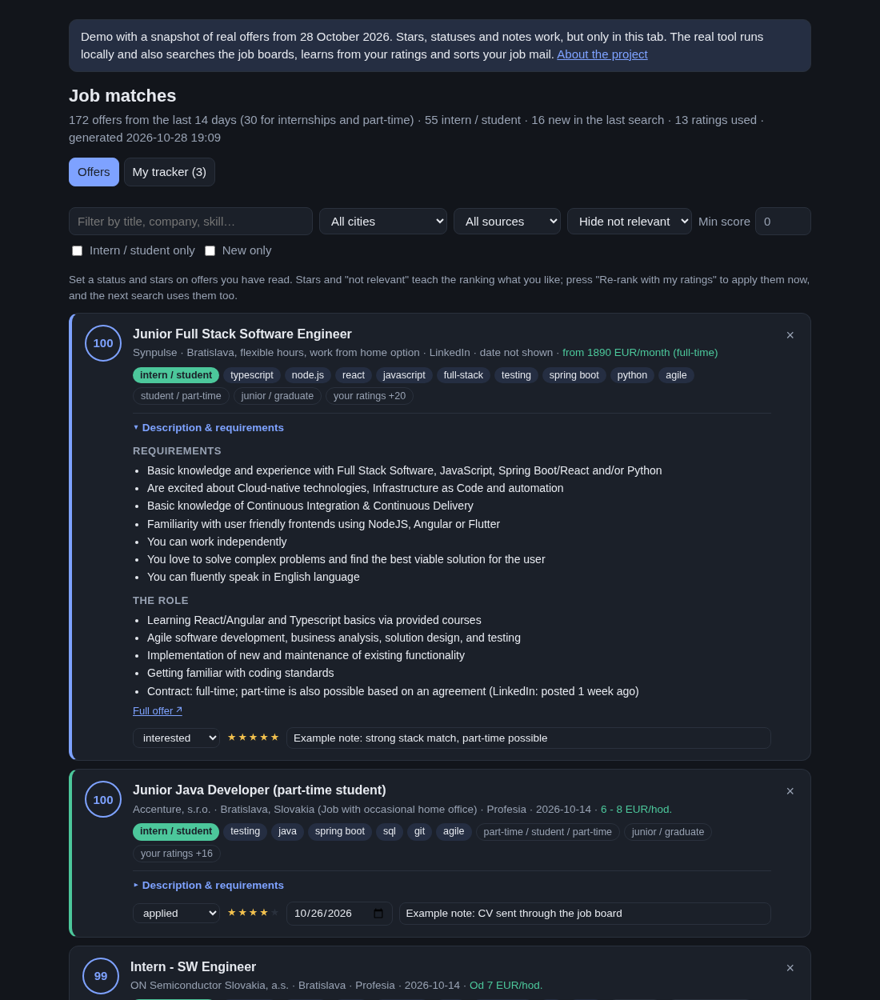
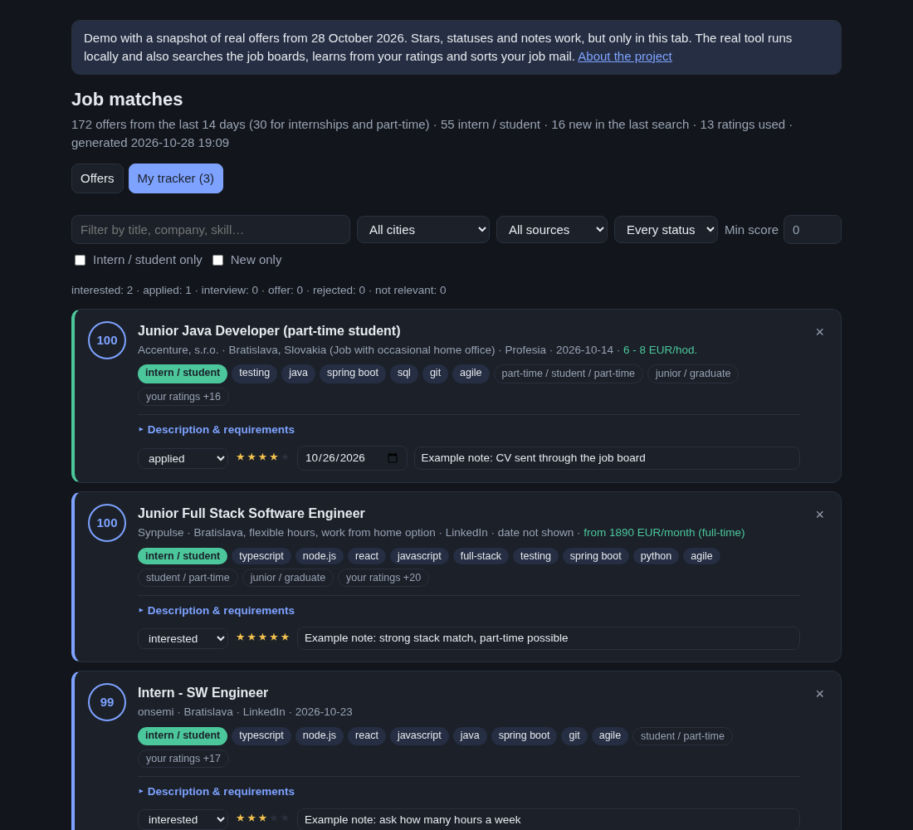

# JobFinder

A local job-search assistant for students. It searches Slovak and Czech job boards, ranks every offer against a CV,
learns from how you rate offers, tracks your applications, sorts the replies in your mailbox, and can send headless
Claude Code agents to research company career pages overnight.

**[Project page](https://omaribrahim22.github.io/jobfinder/) · [Live demo](https://omaribrahim22.github.io/jobfinder/demo.html)**
(a snapshot of real offers; rating and tracking work in the browser)



## What it does

- **Searches** profesia.sk, jobs.cz and worki.sk for the configured locations, including searches limited to
  internships, part-time and student contracts. LinkedIn's public search is supported but off by default, since its
  robots.txt disallows automated access.
- **Filters and ranks** offers: title rules drop senior, sales and non-IT roles, skills are weighted from your CV,
  and student-friendly contracts get a strong bonus while full-time, shift work and training academies are penalised.
  The same offer from several sources is merged.
- **Learns** from your star ratings and "not relevant" clicks, and adds title words you keep liking as search terms.
- **Summarises** each description into contract facts, requirements and the role, in an expandable panel.
- **Tracks** applications (status, stars, notes, dates) in a local web page at `http://127.0.0.1:8765/`.
- **Sorts job mail** (`inbox.py`): a read-only IMAP check where Claude classifies replies (interview, offer,
  rejection, needs a reply), links them to applications, drafts answers and updates the tracker.
- **Researches the web overnight** (`night_web_search.sh`): headless Claude Code agents follow
  [`web_search_brief.md`](web_search_brief.md), verify each offer page and save structured JSON, which is merged into
  the ranking. Runs resume after usage limits, and the agents may only search, read pages and write to one folder.



## Setup

Needs Python 3.11+ on Linux (systemd for scheduling). The night-time web search and mail sorting also need the
[Claude Code](https://claude.com/claude-code) CLI.

```bash
git clone https://github.com/OmarIbrahim22/jobfinder.git ~/jobfinder
cd ~/jobfinder
./run.sh --open          # first run: creates .venv and config.toml, searches, opens the tracker
```

Edit `config.toml` to set your locations, search terms, title filters and skill weights (take them from your CV).
Your settings, tracker, cached descriptions and mail stay in files that git ignores.

Common commands:

```bash
./run.sh --serve                  # open the tracker without searching
./run.sh --rescore                # re-rank the last search after editing config.toml
./run.sh --add-web results.json   # merge offers found by web search
./night_web_search.sh             # run the web-search agents now (FORCE=1 outside 02:00-07:00)
```

### Running it on a schedule

`deploy/` has systemd user units, written for a clone in `~/jobfinder`:

```bash
cp deploy/* ~/.config/systemd/user/
systemctl --user daemon-reload
systemctl --user enable --now jobfinder.service jobfinder-search.timer   # tracker + daily search at 09:00
systemctl --user enable --now jobfinder-websearch.timer                  # optional: weekly night-time web search
```

### Mail sorting

Create an app password for your mailbox and keep it in the desktop keyring (details at the top of `inbox.py`):

```bash
secret-tool store --label="Job finder mail" service jobfinder-mail user you@example.com
```

## How it is built

| File | Role |
| --- | --- |
| `jobfinder.py` | Scrapers, filtering, scoring, preference learning, description summaries, report and tracker server |
| `inbox.py` | IMAP mail check and Claude-based sorting |
| `night_web_search.sh` | Scheduled web-search agents with resume and least-privilege permissions |
| `web_search_brief.md` | The agents' task brief and output schema |
| `tools/build_demo.py` | Builds the public demo page from a report |
| `docs/` | Project page and demo (GitHub Pages) |

Python with Requests and BeautifulSoup, a vanilla-JS single-page report, systemd for scheduling, and Claude Code
for the agent and mail parts.

## How it was made

I designed the tool and its rules, reviewed every change and tested it against the real job boards. Claude Code was
my pair programmer for writing the code.

## Updating the demo

```bash
./run.sh --rescore && .venv/bin/python tools/build_demo.py   # writes docs/demo.html from the latest report
```

## License

MIT, see [LICENSE](LICENSE).
